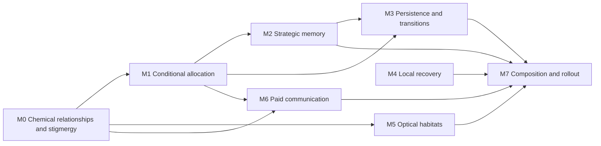

# Conditional specialization and local coordination

**Status:** V55 controls, local mortality recovery and constructed existing paths delivered
through the pipeline October13. October14 corrects the broader delivery claim: M1's static
reflex did not implement experience-dependent allocation, and M3's in-place substrate switch
did not implement habitat transitions. The [allocation repair](SWARM-ALLOCATION-PLAN.md) adds
a concrete shared activity-dependent mechanism. Spatial discovery/abandonment and evolved
collective organization remain outside that delivered result. Historical findings below retain
their original conditions and limits. The user authorized a fresh v55 world at that publication.

**Sulion root:** `0fcb0412-e105-4318-a943-08d4cb894782`.

## Outcome and scope

Develop different inherited relationships to shared chemistry, useful changes of activity
within those inherited capacities, and local interactions that change what becomes worthwhile
next. The complete design connects material succession, private experience, strategic memory,
persistence, local recovery, optical investment and communication through accounted physical
opportunities. It must explain how a benefit reaches the cell paying for an action, or its
descendants, rather than treating neighborhood benefit as an individual incentive.

This revision replaces the October 12 outline. That outline compressed the chemical-key
investigation into a producer/consumer fixture, scattered strategic usefulness across other
milestones, and proposed a precise local recovery formula before resolving its spatial
meaning. The revision restores those design obligations, incorporates the October 13 corrected
baseline, and starts with chemical stigmergy and conditional allocation as the swarm source
recommends. Local recovery is an independent workstream, not their prerequisite.

The core scope remains the eight recent directions below. Generalism, exploitation, silence
and productive permanent residence remain valid outcomes. Do not prescribe roles, a number
of strategies, migration frequency, language or indefinite coexistence. This does not reduce
the scope to an authored demonstration: selected changes must serve ordinary mutable cells,
births, continuing execution, native/WASM consumers and the existing bounded observers.

Configuration-based investigation is part of delivery for every milestone. Each delivered
mechanism needs an independent enable/disable control and its relevant shared settings,
usable quickly through the existing operator and local configuration paths. These controls
ship with the mechanism; they are not deferred to M7 or to a separate tooling project.

| Source direction | Milestones | Obligations retained |
| --- | --- | --- |
| [Chemical keys and broad processing](../design/chemical-key-specialization.md) | M0 | Explain recognition versus expressed breadth and cycling; investigate accessible inheritance, funded capacities, protection, conditional returns, neighbor consequences and replacement. |
| [Chemical stigmergy and metabolic succession](../design/swarm-intelligence-directions.md#chemical-stigmergy-and-metabolic-succession) | M0, M1 | Establish actual chemical dependency, then behavior responding to the changed condition, including producer and consumer costs and subsequent removal or creation of stimuli. |
| [Experience dependent allocation](../design/swarm-intelligence-directions.md#experience-dependent-allocation-within-inherited-capacities) | M1 | Separate immediate inference, recurrence, plastic traces and slow context; improve allocation within the same inherited repertoire without rewarding activity itself. |
| [Vocalization and strategic controller usefulness](../design/vocalization-and-strategy-usefulness.md) | M2, M3, M6 | Develop history, anticipation, local rhythms, inherited experience and learning independently of speech; develop message content, bearing, interference and sender return independently of strategy; account for both together. |
| [Recovery from declining returns](../design/swarm-intelligence-directions.md#recovery-from-declining-returns) | M3 | Distinguish transient shortage from sustained deterioration, with accessible alternatives, travel costs and temporal evidence of habitat transitions. |
| [Local mortality feeding](../design/local-mortality-feeding.md) | M4 | Resolve physical support and local/global severity composition; trace eligibility, admission, composition, release, access and survivor replacement conservatively. |
| [Light, shade and emission usefulness](../design/light-usefulness.md) | M5 | Develop geographic shade, paid cover, sensing and emission separately, including substrate, recipient, reach, timing, replacement budget and paying-cell return. |
| [Communication beyond local chemical cues](../design/swarm-intelligence-directions.md#communication-beyond-local-chemical-cues) | M6 | Identify nonredundant information, an actionable listener choice and a physical return path to the speaker; preserve evolvable content. |

[Dynamic terrain](../design/dynamic-terrain.md) and
[reservoir storage](../design/reservoir-storage.md) retain their explicit deferred disposition
under the eight-direction scope assumption. Existing terrain, seasons, finite supplies and
chemical turnover provide changing conditions here. The v54 external boundary profile is a
delivered ownership correction, not selection of reservoir buffering or dynamic terrain.
Neither older proposal is silently absorbed or claimed delivered by this plan.

## Corrected baseline and evidence provenance

The [October 13 registry](../design/directions.md#corrected-mechanisms-and-evidence-baselines--october-13)
and current [work order](../design/README.md) distinguish fixed defects from unresolved research.
Carry source revision, binding law, complete configuration and active mechanisms with every
reused finding. Checkpoint layout alone is insufficient: the binding correction changed the
law without changing its physical layout.

| Delivered correction | Current contract | What remains unresolved |
| --- | --- | --- |
| V54 refill amplification, `c8404bd` | A reservoir has one finite inventory `Q*p` and a normalized external boundary `b` owning no material. Recovery changes inventory only. Imports contribute `R*b` and its potential; retained contents mix conservatively. The persistent interface uses `b`. | Local/global distress, eligibility, chemical suitability, timing and survivor return. A local severity increase cannot substitute for this already delivered ownership fix. |
| Startup stocks, `573b95e` | Rate 0.1 with lifetime 1200 retains full batches and reservoir-derived priming; gap 600 remains. Rate changes affect stock as well as discharge. | Establishment, ongoing release ceilings, later renewal and recovery are different causes. The first v50 extinction does not isolate ineffective recycling. |
| Finite binding, `0e9ecee` | One partition including an unbound state bounds total affinity at one per site. Bias controls occupancy, weights relative preference. Saturated uniform recognition approaches 1/256 per identity. | Broad composed metabolism, accessible inherited alternatives, conditional protection and persistent differences. Universal full-strength binding is no longer an unexplained behavior to fix. |
| Actuator feedback, v48 `ff175da` | Transporters, enzymes, builder and emitter report accepted signed effect relative to full-effort capacity. | Execution feedback is not marginal benefit or a learning target. The missing return cannot automatically be blamed on absent activity feedback. |
| Slope transport, `e754743` | The face coefficient follows net exchange direction; uniform fields remain uniform across resolution. | Earlier strong ridge-to-hollow pooling cannot establish useful geography-mediated chemistry. Preserve conductance and paid motor resistance without restoring the artifact. |
| Explicit harness conditions, `7ab52b8` | Worlds name a preset or provide a complete configuration. | A failed route or controller probe must not be attributed to biology when terrain, seasons, source placement or supply changed implicitly. |

The [mortality ownership correction](../design/mortality-recycling.md#october-12-correction-finite-contents-and-external-supply)
reports a three-hour corrected live observation with improved early replacement through
ordinary renewals. It ends before the earlier collapse and does not isolate a single cause
or establish lasting rescue. Photoreception, cover, emission, vocalization and strategy were
disabled; that observation supplies no benefit or harm estimate for those features.

The [finite-food recovery comparison](../mortality-recycling-results.md) still matters:
recovery funded more growth but shorter survivor life, with no external refill during the
comparison. Future-refill amplification cannot explain that negative result away. Admission,
intake, growth and endurance remain distinct quantities.

The [binding correction](../key-binding-correction.md) establishes paid differential access,
protection and reciprocal sign epistasis under the corrected partition. Earlier
[food-chain](../rugged-community-results.md) and
[ordinary ecology](../rugged-ecology-results.md) findings retain their independent-sigmoid
law; they are not retroactive evidence of corrected-law communities.
The unpublished local October 7 key consequence (`docs/key-consequence-results.md`) uses the corrected
binding law: a single transporter-weight alternative improves import/conversion alignment,
paid work and survival in the captured neighborhood while isolated finite-bath probes remain
negative. It establishes an individual causal consequence, not a persistent complementary
community. It predates v54 supply ownership; retain that supply revision rather than treating
the replay as evidence for the complete current baseline. Preserve these local authored findings
and examples without taking ownership of unrelated untracked work.

The [v42 light checks](../light-ecology-results.md) establish sensing, attenuation and
detectable emission without positive whole-cell shelter/lamp return.
The [v49 utterance/strategy checks](../utterances-and-strategy-results.md) establish paid
delivery and an authored context-to-action path without measured strategic or communication
payoff. Both records predate current binding and supply. Preserve their negative results and
conditions; neither record diagnoses a specific broken optical or neural operator.

## Shared physical and mathematical design

### One physical consequence loop

The common state is external and internal mixtures, inherited compiled recognition and exact
transformation programs, capacities expressed at current biomass, usable work and injury,
local exposure, and private neural state. The common loop is:

```text
local material / exposure / received events
    -> funded local readings and private history
    -> bounded reflex effort, influenced by held strategic context
    -> finite requests, shared donor and frozen-work allocation
    -> accepted transfers, exact conversions, movement and paid emissions
    -> changed local material / exposure / future readings
```

The [composed laws](../design/chemistry/composed-runtime.md),
[transformation algebra](../design/chemistry/transformation-algebra.md),
[funded physiology](../design/funded-bodies.md) and
[controller contract](../design/controller.md) remain authoritative.
Candidate revisions belong in those owners when selected; this plan is not a second equation
source. Historical radial or single-profile descriptions in older material do not supersede
the finite binding correction or v54 ownership.

Recognition and phenotype are different stages. Keep this chain explicit:
inherited key -> compiled affinity -> funded capacity -> chosen effort -> accepted exchange
or conversion -> net return. A changed unused key, broad support, high activity, gross cycling
or a dominant displayed identity cannot stand in for the later stages. Protection changes
exposure and permeability without changing reference chemical potential. Exact discrete
actions remain exact; smooth kinetic mixtures are not themselves invertible group actions.

### Neural state, clocks and credit

Reuse the 83x24x28 reflex network on the 0.8-second physiology clock and 61x8x5 strategic
network on eight physiology intervals. Both use the same recurrence, bounded activation,
incoming row budget and paid trace operation. The effective reflex recurrence is
`W + abs(alpha)*H`; experience changes bounded traces, not physical capacities.
Actual actuator feedback is `a/(abs(a)+C)` with accepted signed effect a and the same interval's
full-effort capacity C. Neither that ratio nor an energy-fill change isolates the causal
value of one action amid simultaneous transport, repair, movement and reactions.

Keep four sources of behavior separate: current readings, recurrent state, paid learned
traces, and strategic context/learning gain. A useful immediate reflex does not demonstrate
learning; a useful held context does not demonstrate strategic learning. Additional neural
features need a missing usable distinction, not a desire for larger networks or individual
enzyme threshold rules. No action receives a designer-computed benefit, reproductive score
or global loss signal.

Body proportions and complete chemical capabilities are birth-fixed. The common heavy-tail
mutation distribution and domain transforms remain; rare large effects must follow from
that law and the inherited interaction map. No feature-specific mutation bonus or specialist
filter. Birth-local assimilation copies the permitted acquired weight contribution once into
offspring, without rewriting a shared parent genotype. Reflex memory, byte and pending hearing
reset; strategic hidden state, long memories and context copy by the installed birth rule.

### Physical accounts, ownership and durable state

Material stays with existing owners: dissolved field, one reservoir inventory, free cell
mixture, bound body mixture and overhead film. External supply profiles and neural history
are not material stocks. Recovery redirects actual body chemistry; speech dissipates paid
work; optical emission allocates finite paid work once; sunlight remains external.
No private compartment, construction/refitting, parental-function buffer, living-cell gene
transfer, role reward, kin rule or preferred chemical is introduced.

Rust owns physical and private state. Persistent regions own local commits; reads freeze
before shared donor/work reductions and all parallel phases join before observation or save.
Compile genetic profiles once at birth and retain immutable sharing. Added local histories
must have bounded support, physical-time decay and regional invalidation, not world-wide
rescans or per-worker world-sized buffers. Numerical tile width cannot select a biological scale.

Use the existing [ownership contract](../design/chemistry/data-ownership.md): local rendering
borrows WASM views in its worker; native observers and spectators receive bounded projections,
never full private/chemical frames through React. Durable physical or private additions require
codec, validation, birth/reset and continuation semantics together. Rebuild derived membership
on restore. Change checkpoint format when needed; do not add migration or require byte-identical
future trajectories.

## Configuration and rapid investigation controls

### One typed configuration, available with every feature

Extend the existing Rust `Config`, camelCase JSON, feature controls, validation and presets.
Use the same resolved configuration for native execution, local WASM and diagnostic runners.
Feature switches select participation or a documented baseline; settings remain the small
set of shared physical/neural parameters with explicit units and bounds. Operator switches
are experiment controls, not per-cell genes, ecological incentives or extra tunable mixtures.
Do not add a separate flag service, build-time variants or duplicated native/browser laws.

The current [run controls](../exploration-ablation.md) already expose
`features.photoreception`, `features.cover`, `features.emission`,
`features.vocalization`, `features.strategy`, `mortalityRecovery`,
`radialFounders` and terrain switches. The current
[management API](../server-management.md) applies configuration through restart, and
`frontend/harness/native_run.py` merges JSON patches or repeated `--set PATH=JSON`
overrides into the running world's effective config. Live patching below is planned work,
not a claim that the current API supports it.

Extend those paths so an operator can inspect current settings, preview a patch, apply several
related changes together and confirm the effective result without rebuilding or redeploying.
Keep named JSON patches under `config/` for ordinary all-on operation, a declared baseline,
and focused comparisons. Avoid enumerating the entire flag power set. Preserve unrelated
settings when applying a partial patch; unknown fields, invalid values and incompatible
combinations fail explicitly rather than reverting to defaults.

### Live changes first; structural changes explicitly require a new world

Classify every flag and setting by what changing it actually affects:

| Change class | Apply behavior | Examples and boundaries |
| --- | --- | --- |
| Execution participation | Live, at the next complete owning boundary, with explicit off/on state and cost semantics. | Speech, emission, strategic influence and selected new optional effects. Disable future activity and its operating costs; do not create capacity or erase existing material. |
| Shared runtime setting | Live where the operator can preserve accounts, causal timing and derived-state validity. | Selected recovery, optical or control parameters. Integrate elapsed time under the old value, invalidate affected prepared work, then use the new value prospectively. Publish units, range and application boundary. |
| Birth interpretation or world structure | Explicit fresh-world restart using the fully merged config. Never silently restart a live patch. | Recognition representation, settings defining immutable birth-compiled capabilities, founder body allocation, topology, geometry and terrain generation. Existing `radialFounders` changes startup interpretation, not living keys. |

Prefer live controls for supported participation and runtime parameters. A new-world-only
restriction needs a concrete inherited-state, physical-ownership or structural reason; current
API limitations alone are implementation work, not grounds to make every new feature restart-only.
Expose each control's class and reason through the existing operator/status interface so the
client can preview exactly which edits apply live and which require restart. A mixed patch
requested as live is rejected as a whole if any field requires restart; no partial application
or automatic world replacement. Restart uses the existing explicit operation.

Apply a live patch atomically on the sole World owner after complete jobs join. Check the
world generation and expected configuration revision; report the actual applied revision and
tick/boundary. A queued setting may affect the next physiology or source boundary, so report
that pending state separately from an effective setting. Reuse authenticated LAN-only
`/api/control` and the existing local worker command path; public spectators cannot tune
the world. Extend the maintained helper with explicit live/restart selection and preview,
using JSON files and repeated path overrides rather than a new control application.
An uncertain command is never automatically retried; inspect status before another write.

### Off/on behavior must preserve physical meaning

Publish both participation and cost semantics for every switch. A live activity-off control
removes that activity's influence, future work and learning expenditure where applicable.
Already-funded body capacity remains physical, occupies its existing share and pays ordinary
body maintenance; re-enabling can use that existing capacity but cannot manufacture an absent
organ. Full no-organ/no-associated-body-investment ablations remain explicit fresh-world
configurations. Do not refit inherited proportions or refund body mass when toggling.

Likewise, disabling cover building stops new builder actions; existing film remains accounted
material with its physical optical effects. Disabling recovery leaves previously recovered
inventory available under ordinary release. Already-paid emission and received speech need a
declared settle/consume policy at the cutover, not duplicate delivery, deletion of conserved
work or a retroactive refund. A flag must not claim that these historical consequences vanished.

Disable strategic influence with neutral reflex learning gain and without strategic inference,
learning or additional upkeep. Separate optional private learning from inherited assimilation
using the existing policies. Declare whether each affected history, context, trace and event
state is held, cleared or rebased, and how re-enabling initializes its integration clock.
No unpaid catch-up learning, stale held actions, duplicate impulse consumption or extra
assimilation can occur. Rebase sensing/clock state where necessary without silently replacing
genotypes, resetting all private experience or rewriting history.

### Coverage and settings owned by each milestone

Every selected new operator or coupling must have an off/baseline mode even when the containing
research direction spans several processes. A research outcome such as stigmergy or migration
is not itself an independent actuator: expose its contributing mechanisms and any delivered
revision, not an artificial switch that manufactures or suppresses the outcome.
Fixed defects remain fixed in all modes; no flag restores sigmoid saturation, refill
amplification, redundant stock inputs or erroneous slope pooling.

| Milestone | Required independent control and setting coverage |
| --- | --- |
| M0 Chemical relationships | Preserve explicit keyed/radial fresh-world selection and binding settings, classifying birth-compiled changes correctly. Any additional chemical/protection/coupling revision gets a corrected-baseline selector. Export, sensing and transformation participation are identified separately when used as interventions; no global “cooperation” flag. |
| M1 Conditional allocation | Separate private plasticity, recurrence/held-state diagnostic interventions and birth-local assimilation. Reuse `learning`, `plasticityCost`, `learningRetention` and shared parameters; any selected learning revision has a baseline mode. State and cost effects are explicit, with no per-enzyme learning knobs. |
| M2 Strategic memory | Independent strategy participation, context influence and learning interventions; expose relevant existing clock/cost settings and any justified shared additions. Heritable retention/timescale loci remain genes, not arbitrary operator replacements of living genomes. Speech stays independent; strategy-off preserves neutral-rate reflex learning. |
| M3 Persistence | Control the actual memory, conditional coupling and environmental drivers used by the delivered path, reusing M1/M2 and existing supply/season/motor settings. A new persistence coupling gets an independent baseline selector; no artificial migration toggle or escape timer. |
| M4 Local recovery | Independent recovery participation and selected global/local response mode; reuse `mortalityMemory`, `mortalityHalfResponse` and shared source settings. Live mode/history transitions must conserve existing stock and define history initialization. The unresolved local/global composition is not selected merely by naming its control. |
| M5 Optics | Separate geographic attenuation, photoreception, cover building and emission. Reuse `terrain`, the three existing optical feature switches, `shadeStrength`, `opticalColumn`, `opticalReach`, `opticalPowerDensity` and illumination settings as applicable; distinguish static-map regeneration from runtime exposure. Separate chemical-work and information interventions without new prices per recipient. |
| M6 Communication | Independent speech and listening interventions, content/bearing diagnostic controls and relevant shared work/reach settings, including `utteranceWorkDensity`. Ear participation and body investment have different live/startup semantics; strategy need not be enabled. Any changed reception/coupling has a baseline mode. |
| M7 Composition | All-on and focused config patches, complete effective-config visibility, live/structural classification and consistent native/WASM/harness behavior. M7 checks interactions; earlier milestones already ship their usable controls. |

M0 establishes only the necessary shared configuration patch/readback support through the
existing owners, including the checkpointed comparison workflow below. Each milestone adds
its own entries, validation, transition behavior,
persistence and focused checks as it delivers its mechanism. Independent M4 work reuses that
support when present or includes the same bounded prerequisite in its own expansion; it does
not wait for M0's chemical findings or start a separate observability project.

### Server save points, rewind and stable feature comparisons

The purpose is to compare feature variants from the same world state, with reliable
configuration and observations. The agent must be able to save a point, change flags or
settings through the server API, run and inspect the world, rewind, and try another variant.
The observation period follows the research question: elapsed model time, source renewals,
a meaningful event or an adequate behavior window. A tick count is one possible choice,
not a feature requirement. Record the actual interval and use comparable windows where
needed to interpret differences.

**Reuse:** Stored checkpoint save/list/load, pause/resume, speed, status and ecology inspection
already exist in the authenticated API. Reuse these operations and the maintained management
client. The required extensions are live feature/settings patches and loading a checkpoint
into a paused world so the next variant can be configured before it runs. Once installed,
these operations require no deployment, process restart or reseeding between variants.
The agent runs the comparison through these ordinary controls.

**Comparison workflow:**

1. Pause and save a durable checkpoint S, recording its tick and effective configuration.
2. Apply variant A's settings and confirm them before resuming. For example,
   `mortalityRecovery=false` stops new death-derived admission while leaving ordinary
   external refill and previously recovered inventory accounted.
3. Run, monitor and pause when the chosen comparison window is sufficient. Retain A's
   observations and effective settings locally before rewinding.
4. Restore S while paused, including its physical/private state, clocks, random streams
   and original configuration. Apply and confirm variant B's settings, then run and
   observe under the same declared comparison conditions.
5. Compare actual intake, conversions, costs, reserves, growth, replacement and relevant
   behavior. Report the observation windows and limits, and the world/configuration/running
   state left at the end.

A shared checkpoint gives the variants the same initial cells, inherited and private state,
chemistry and supply conditions. Subsequent trajectories may diverge; byte-identical future
replay is not required. Preserve unchanged settings and use the existing generation checks
to avoid operating on a replaced world. Structural/birth-only changes remain outside live
patching and must not silently create a different initial population.

The checkpoint must be successfully stored and retained for the comparison. Reuse manual
retention and storage errors; do not add a new save-point registry. Keep each variant's
observations separate using existing local captures and ecology segments, with the checkpoint,
settings and actual interval identified. Rewinding physical state must not erase earlier results.

M0's shared operator support delivers these API gaps early; each feature ships its own controls.
Acceptance covers confirmed live settings, paused restore without unintended advancement,
checkpoint continuation, and retained observations for two variants from one save point.
Use short checks of these operations. Existing pause/resume and monitoring are sufficient:
no exact-step API, server experiment scheduler, run lifecycle, automatic stopping policy or
durable experiment-control state is required. M7 checks composition of the same controls.

### Durable, attributable interventions

Physical checkpoints retain the complete effective configuration and configuration revision,
plus any pending update needed for unambiguous continuation. Restore must not silently apply
new process defaults to saved flags. Keep bounded intervention records with generation,
tick, revision and changed settings in existing ecology diagnostics; mark observation windows
that cross a change so their effects and costs are not attributed to one unchanged treatment.
Retain effective configs with local captures and comparison presets. No unbounded event log,
new database or automatic experiment campaign is required.

Each milestone checks its enabled, disabled and re-enabled paths, relevant dependencies,
invalid-patch rejection, cost/material accounts and save/restore at a control boundary.
Use short constructed checks; do not expand to the full feature power set. A feature is not
delivered until these controls work through ordinary operator/config paths, independently of
whether a population discovers the opportunity.

## Dependencies and delivery order



Begin M0 and then M1: chemistry supplies a real consequence and reflex control a response.
M2 gives history its own design and delivery obligation; M3 applies it to interruption,
deterioration and travel. M4 can proceed independently against the delivered v54 baseline.
M5 needs chemical opportunities from M0, not completed communication. M6 can use direct
reflex hearing without strategy; M2 supplies an additional memory consumer, not a prerequisite
for speech usefulness. Optical information and movement can enrich M6 without mandatory
dependencies. Numbering is the default delivery sequence, not a claim of mathematical dependence
or authorization for parallel agents.

Each milestone includes its own design resolution, complete ordinary implementation,
persistence, observations and bounded checks. M7 handles actual interactions and rollout;
it is not the first integration or a separate verification/acceptance stage.
The configuration contract above is part of every milestone's acceptance, including its
independent switches, relevant settings, effective readback and documented off/on behavior.

## M0 Chemical relationships and stigmergy

**Sources:** Chemical keys/broad processing and chemical stigmergy/metabolic succession.
**Dependencies:** Delivered finite binding and v54 supply; no pending milestone.
**Delivery:** Consequential inherited alternatives and a complete chemical-feedback path using
the current laws, with necessary shared revisions integrated into ordinary consumers.

### Explain breadth before changing recognition

Resolve five competing descriptions in the same recorded surroundings:

| Explanation | Required distinction | Design consequence |
| --- | --- | --- |
| One site recognizes broadly | Full compiled affinity and total occupancy, funded stock and actual requests | Finite affinity already limits breadth; assess whether it gives a conditional capacity advantage, not a breadth tax. |
| Selective programs compose a generalist | Per-program substrate/product paths versus aggregate accepted conversions | Broad whole-cell processing may be legitimate. Preserve route-level alternatives and costs. |
| Private cycling inflates gross breadth | External import, re-export, retained inventory, repeated conversion and net material/work effects | A large reaction total is not many independent food sources. Do not infer novel diet from gross throughput. |
| Distinct genes are unexpressed | Active versus unused sites, body shares, chosen effort and paid accepted effect | Find the missing funded or neural link before changing affinity or mutation. |
| Different histories or supply explain the contrast | Contemporary exposure and v54 inventory/boundary/import profiles versus lifetime intake and private state | Compare matched inherited alternatives before attributing a changed diet to a mutation. |

Extend the existing inspection/flow reductions only where one of these distinctions is absent.
Do not add unique-molecule tracking or another persistent chemical owner to disambiguate gross
flows. Retain complete compiled profiles alongside measured transfers, not strongest-identity
summaries alone.

Examine accessible inherited changes through the existing key representation and common
mutation law. Weights redistribute preference; bias changes total occupancy and cannot restore
universal binding. Compare meaningful changes in funded transport, enzyme engagement and membrane
protection, including protection's restriction of passive entry and clearance. Preserve occasional
large gains/losses and reciprocal sign epistasis already established physically. Do not reduce
the task to counting keys or force every useful alternative to be a narrow specialist.

### Develop succession as a physical interaction

Use a current-law exact route in which a producer converts accessible material and exports an
intermediate; a co-located recipient can use, be harmed by, or remove that intermediate.
The existing founder circuit is a diagnostic candidate, not a privileged set of identities.
Before choosing it, price the whole producer and recipient route under the finite partition,
actual retained mixtures, donor competition, maintenance, transport, repair and conversion work.

The interaction must include both environmental dependency and response:
producer effort -> accepted export -> persistent local mixture change -> funded recipient
reading -> changed ordinary effort -> accepted conversion -> subsequent changed condition.
A fixed consumer using accidental waste establishes dependency, but does not establish adaptive
coordination. Include removal or creation of a subsequent stimulus so metabolic succession is
more than a two-cell throughput measurement. No stage label, shared clock, pheromone field or
community objective orchestrates the sequence.

**Implementation and decision:** Reuse `binding.rs`, birth compilation, existing transport,
reaction, membrane and controller owners. First resolve whether a missing consequence is in
recognition, capacity, access, cost or expression. Select a shared revision only at that broken
relationship; an already complete installed path can satisfy it. Keep different genotype returns,
neighbor response and inherited accessibility explicit even if the same correction serves all.

**Evidence and acceptance:** Reuse the corrected-law single-key neighborhood replay; preserve
its pre-v54 supply conditions, isolated negative controls and the older-law food-chain limits.
A bounded producer-export
intervention distinguishes dependency; a separate held recipient response distinguishes behavioral
feedback. Control exposure and private experience and compare common-time costs. Follow contrasting
co-located descendants through a budgeted ordinary renewal/replacement interval when judging
persistence, separating inherited retained differences from transient individuals. Persistent
complementary roles remain unestablished if coverage is insufficient; neither a long coexistence
campaign nor a required role count is a delivery gate. The installed path must plausibly support
the intended consequence in ordinary cells, not only pass a binding-curve or fixture check.

## M1 Conditional metabolism and paid learning [depends on M0]

**Source:** Experience dependent allocation within inherited capacities.
**Delivery:** The same physical repertoire can use changing local information and private
experience to allocate effort between differently valuable routes at their actual cost.

Use two existing usable routes whose relative net returns reverse with a declared supply change.
The key question is effort within one birth-fixed repertoire, not replacement of its machinery.
Start with fixed physiology and declared mutation/private-learning/assimilation settings.
An outward reading can expose supply; inward readings, retained mixture and accepted activity
can expose processing or saturation. Calculate whether both allocations are affordable and
whether reversal actually changes their net value before calling a failure maladaptation.

Build the causal account in order: cue change, neural state change, transporter/enzyme effort,
accepted material and work, then growth/repair/reserves. Separate an absent cue from a cue the
network cannot use, a physical request that cannot be funded, and a learning update that fails
to improve allocation. A high-activity enzyme may merely cycle retained material.
Energy-fill changes mix several causes, so do not reinforce the busiest program or treat
a global net-return calculation as a new per-enzyme reward.

**Recommended design:** Keep one neural action vector and the installed shared paid trace law.
Use immediate readings where they suffice; recurrent state for short context; paid plasticity
for experience. M2 owns long history and anticipation. If a missing relationship requires a
revision, change the common observation transform or bounded neural coupling across affected
actions, with explicit domains and cost, rather than add independent task thresholds, learning
rates, allocation probabilities or an auxiliary metabolic dispatcher.

**Discriminating interventions:** Compare the responsive path with matched held recurrence or
trace state, one distinction at a time. Keep physical genotype and initial material/work fixed.
For information attribution, preserve comparable inference/learning expense where meaningful;
separately use ordinary feature-off operation for actual cost/benefit. Freezing mutation does
not freeze assimilation; static learning and zero retained learning answer different questions.
Do not manufacture a learning claim from an authored reflex with a successful supply response.

**Implementation and acceptance:** Resolve the cue/credit diagnosis and any selected common
revision in `controller/learning.rs`, controller cue publication and transport/reaction action
owners. Preserve incoming row budgets, paid-time trace clocks, static-learning semantics,
immutable genotype and birth-local assimilation. Include private-state restore, new-birth reset,
and bounded cue/effort/accepted-flow observations. Ordinary startup retains mutable controllers;
diagnostic weights never become an undeclared production task policy. Delivery establishes an
available, accounted route to useful adaptive allocation and an honest attribution of which
state provides it; it does not require evolutionary discovery in a campaign.

## M2 Useful strategic memory [depends on M1]

**Source:** The independent strategic half of vocalization/strategy usefulness.
**Delivery:** History, anticipation or inherited experience can improve a decision that immediate
readings alone cannot achieve as economically. Speech is not required for this milestone.

### Compose the installed memory clocks

The strategic interval is 6.4 model seconds. Each history channel has the same level, surprise
and volatility operation: interval mean, mean minus long expectation, and long mean absolute
deviation. The organism-wide `T_long = 6.4 * 2^lambda`, lambda in [2,8], spans 25.6–1638.4
seconds; default lambda5 gives 204.8 seconds. Hidden retention is a separate heritable recurrent
operation, with effective decay time `-6.4/log(r)` for 0<r<1. These two memories are not
interchangeable. Context is held between evaluations; gain in [0,2] scales reflex trace time and
its paid cost together.

Relate those clocks to the selected environmental cue's duration, recurrence and predictive lead,
physiological reserve, action delay and travel time. Current local phases and elapsed empty time
are allowed; remaining random refill wait, raw tick and distant state are not. Present seasonal
phase can support anticipation without an oracle, but nonzero context alone demonstrates none.

**Concrete design situation:** Select a funded route where the same current local reading has
different implications after a brief interruption versus a persistent loss, or where a present
permitted rhythm predicts a change early enough to justify advance effort. M3 uses the former;
seasonal metabolic preparation is a candidate for the latter. A useful strategic comparison must
include a genuinely ambiguous present or a useful lead time. An immediate cue that already tells
the reflex everything cannot establish strategic value.

### Identify representation, coupling, learning and heredity separately

Trace the eleven shared history channels, present rhythms, life-history information and previous
contact display into held context, learning gain, reflex action and paid consequence.
Context currently shifts reflex hidden preactivation through four inputs; it is not a direct
motor/metabolic command. Founder context-to-reflex connections start at zero. Distinguish an
unused accessible connection from a representation incapable of preserving the relevant
distinction. Inspect the inherited retention, timescale and common mutation/learning path;
do not solve an unused connection by automatically enlarging the network.

Account separately for reflex inference/upkeep, strategic inference/upkeep, reflex learning,
strategic learning, and gain-induced extra reflex learning. Installed strategic upkeep adds
`605/(3292*8)`, about 2.30%, to controller upkeep; that is not its complete learning expense.
Strategic learning uses energy-balance surprise under the shared bounded paid trace law.
Assess whether that modulator and context coupling express the selected opportunity before
proposing a different shared operation.

Birth copies strategic hidden state, long memories and display; each layer's permitted
acquired-weight contribution assimilates separately. Newborn reflex hidden state, traces,
private byte and hearing reset. Copying strategic state and assimilating a learned weight
are different paths; avoid transmitting a trace contribution twice. Inherited memory may
help a daughter in the same environment and mislead it after a changed condition, so record
the environmental relationship rather than treating inheritance as automatically useful.

**Implementation and acceptance:** Resolve the selected opportunity, timing and coupling in the
existing controller module and `strategic-controller.md`; preserve common operators and the
perception boundary. Use matched present readings with altered prior history or held context
to distinguish memory, and separate gain from context where it changes the decision.
Diagnostic state interventions must not silently grant work or change bodies. Follow context
through ordinary action and net return; test paid learning, copied/reset birth state and
mid-interval restoration for affected state. If no neural revision is necessary, retain the
installed operator and deliver the complete usable relationship and bounded observations.
A constructed path is available strategic value; evolved exploitation remains a distinct claim.

## M3 Persistence and habitat transitions [depends on M1 and M2]

**Source:** Recovery from declining returns; strategic persistence and departure.
**Delivery:** Useful persistence tolerates an interruption while sustained deterioration can
change metabolic commitment or make affordable movement worthwhile.

Use existing finite depletion, donor competition/crowding, product accumulation, exposure,
seasons and source renewal as physical causes. These are alternative explanations, not new
feature-specific hazard rules. Begin with a productive activity and a declared accessible
alternative compatible with the cell's inherited repertoire. Price staying, changing effort
and moving with reserve, age-dependent maintenance, injury, transport, motor and controller costs.
An alternative beyond the available travel budget is not evidence of a switching defect.

Develop two temporal cases around the same physical opportunity: a brief interruption followed
by return, and a sustained relative-return reversal. Use M2's existing surprise, volatility,
retention and long memory to distinguish them; compare turnover and paid-memory times before
adding any forgetting parameter. Persistence through a brief loss can avoid wasted travel;
persistence after sustained loss can exhaust reserves. A universal leave-on-low-energy rule
cannot express both and must not become a separate escape policy.

Use actual chemical contrasts and learned local information for direction. Motor load reports
paid geographic resistance, not progress, a route, remaining distance or a destination.
No compass, migration quota, reproductive score or automatic nearest-reservoir target enters
the controller. A sound bearing, if later available, is an experienced local cue, not an oracle.

**Implementation and evidence:** Reuse M1 action allocation and M2 memory; change only a
demonstrated missing shared coupling. A bounded reversal with swapped starting placement
separates location from conditional response; a brief-interruption control separates useful
commitment from indiscriminate switching. Compare cues, context, efforts, accepted intake,
travel expenditure and common-time reserves before diagnosing a memory failure.
Failure decomposition must cover missing information, incompatible/unavailable material,
unaffordable travel and inappropriate retained behavior.

**Acceptance:** Ordinary cells have an accounted sensory/history/action path to staying,
switching or moving under the declared condition. Productive permanent residence remains valid.
Reuse persistent temporal records to distinguish actual departure, arrival, persistence,
reproduction and new founding. Track moving reservoirs and descendant continuity so grouping
changes or a colony splitting in place are not migrations. Missing coverage stays unmeasured;
inter-colony exchange frequency and long-run founding are research outcomes, not release gates.

## M4 Local turnover and recovery

**Source:** Local mortality feeding.
**Dependencies:** Delivered v54 inventory/boundary ownership and full startup batches.
**Delivery:** Resolve and implement the local response and any necessary delivery relationship
without confusing retained body stock, external imports or paid survivor benefit.

### Establish the unresolved causal chain

The chain is local loss -> actual bound-body chemistry -> eligible footprint overlap ->
admission -> release -> survivor access -> paid processing -> growth, replacement or endurance.
Global growth may mask local loss, but eligibility, gradual deaths, nonlinear severity,
unsuitable chemistry, discharge ceilings, seasons and expressed actions can also break the chain.
Use corrected binding and separate inventory/boundary/import profiles throughout.
The earlier finite-food growth/endurance tradeoff remains a competing effect.

The installed response uses physical-time death rate d, funded growth rate g and living biomass B:
`h = tau*max(d-g,0)/B`, then `f = h^2/(h^2+h_star^2)`, with tau60 seconds and h_star0.25.
These are global quantities; spatially local recipients do not make severity local.
Division creates no loss, founding initializes biomass with zero rates, and explicit population
changes rebase history. Keep those semantics in any spatial form.

**Recommended design to resolve in this milestone:** Apply the same history and response to
physically weighted local death, growth and biomass, starting from existing body/source footprints.
Retain global reductions for diagnosis while comparing replacement versus composition.
Do not carry the October 12 plan's proposed local formula as a selected runtime law.
A local term is the user's likely direction, not evidence that local-only replacement is settled.

### Spatial meaning and conservative delivery

Resolve the following together before installing a local response:

- Define support in world distance from existing material access, not observer colony labels,
  ancestry, cell counts or tile size. Use the same physical weights for deaths, funded growth
  and pre-removal living biomass; explain dilution, seams, empty reference and batch timing.
- Prefer fixed spatial histories under regional ownership so a moving reservoir samples
  conditions where it is. A source-attached history is acceptable only if its movement semantics
  intentionally preserve the same physical meaning; it cannot drag an old colony's distress
  into an unrelated neighborhood. Compare state and update costs of the two representations.
- Choose whether local severity replaces global severity or composes with it. Begin with the
  common response over local histories; justify any global contribution by an otherwise lost
  physical consequence. Do not introduce an arbitrary max, sum or independently tuned blend,
  nor double-count the same deaths at local and global levels.
- Freeze the complete death batch and response reference before recipient commits. Normalize
  eligible overlap once; the recovered fractions across all sources cannot exceed one for any
  component. Free inventory spills normally; remaining usable work becomes death heat.
- Preserve sole inventory ownership: admission changes `Q*p` and never assigns `b`, adds
  external work, extends nominal batch allowance or delays its wait. Stock admitted during an
  empty wait can release at the next ordinary source commit, using no time accrued before arrival.
- Compare delivery time with survivor reserves and source throughput. If an empty-wait or
  composition relationship still prevents useful feeding, revise that shared relationship
  explicitly rather than raising a recovery gain or silently changing normal refill.

**Implementation:** Existing `mortality.rs`, `mortality_recovery.rs`, `source_lifecycle.rs`,
regional state and source commits own the work. Give local histories units, physical-time decay,
bounded sparse support/reactivation, initialization/rebase rules and checkpoint semantics.
Observer reductions report distress, eligible/admitted mixture, actual release and imports
separately; neither recovered amount nor source stock is labeled survivor intake.

**Evidence and acceptance:** Pair a declining neighborhood with an unrelated healthy growing one,
plus balanced local turnover, with matched geography, full startup batches and nominal supply.
Distinguish global masking, capture, delay and unsuitable chemistry through actual paid flows
and common-time returns. Cover overlap, moving sources, seams, empty support, division, batch
order, disabled recovery and continuation. Local decline must not disappear merely because
unrelated growth cancels a global total; balanced replacement must not become a permanent subsidy.
Complete the selected ordinary path and preserve negative findings without an extinction sweep
or a requirement that every colony be rescued.

## M5 Useful optical habitats [depends on M0]

**Source:** Light, shade and emission usefulness.
**Delivery:** Each optical investment has an explicit conditional chemical or information path,
with its recipient, time, paying-cell return and ordinary costs. Do not collapse four different
questions into a single light-on/off population comparison.

| Component | Concrete opportunity to develop | Required return and competing explanation |
| --- | --- | --- |
| Geographic shade | Preserve a useful public intermediate or reduce a harmful public product relative to an exposed location with the same offered chemistry. | Intake, reduced repair or reserve benefit must offset lost solar-assisted processing and any travel. Apparent darkness or terrain pooling is insufficient. |
| Cell-made cover | Create the same useful exposure difference locally through actual film deposition, maintenance and recovery. | The paying cell or descendants need access to the preserved benefit; standing film alone is not payback. Insufficient deposited column, turnover or poor placement can defeat return. |
| Funded sensing | Select effort or location from local exposure before the chemical consequence is otherwise apparent. | The cue must change a paid decision enough to repay sensing and movement; an opposite turn alone establishes agency. |
| Paid emission | Drive a usable conversion at the right recipient/time, or convey information before ordinary chemical cues. | Processing capture and information value are separate. Recipient substrate, competing absorbers, timing, range and controller expression can explain poor return. |

### Compose chemistry, exposure and investment

Keep one scalar exposure and overhead non-depleting sunlight. Public conversion engagement
depends on incident light; private enzyme kinetics retain their existing law, while available
transformation work uses the shared chemical medium and exposure. Shade therefore has no intrinsic
benefit or injury penalty. Select a current-law exact transformation where preserving an
intermediate or avoiding a product changes a funded route identified in M0, and compare the
lost useful processing as well as the avoided conversion. Do not create a special toxin,
spectrum class or shelter reward.

Film optical depth is `mass/(mesh^2*opticalColumn)`; plane transmission is `exp(-depth)`
and film exposure uses its column mean. Derive the material column needed for the proposed
exposure change, deposition time from actual builder capacity, and replacement demand from
ordinary transport, conversion and washout. Price builder body share, work and the material
removed from other uses. Accepted low-volume pruning remains settled; do not lower thresholds
or require a separate numerical-retention investigation to make a thin cover profitable.

Emitter work is paid once under shared reserves. Existing lateral and upward paths distribute it;
material-weighted allocation and the chemical-table work bound limit accepted recipient capture.
Distinguish incident light, allocated work, actual conversion/capture, optical loss and later
material return. An illuminated receiver without compatible substrate cannot establish a lamp
opportunity. A shared allocation correction needs a demonstrated physical mismatch and must
apply to all recipients, not favor a target cell or chemical.

For information, compare message lead time and an exposure-dependent action with existing local
chemical cues. Light can be informative even when chemical energy capture is negligible.
Identify the emitter's direct or descendant return through changed local material or behavior;
a listener benefit alone cannot repay the emitter automatically. M6 reuses this reasoning for
bytes but is not a prerequisite to an optical cue.

**Implementation and acceptance:** Existing `cover.rs`, `optical_accumulator.rs`, public
reaction, funded body, sensing and ordinary controller owners receive selected revisions.
Complete material/work accounts, sparse participation, mid-interval restore and bounded
observations. Use a chemically priced shade contrast, then a funded cover/idle contrast;
separate an emission-processing case from an information case. Hold relevant expense for
information attribution and separately price the actual optional investment. Preserve the
negative shelter/lamp results under their original law. Ordinary startup enables delivered
mechanisms; a diagnostic ablation is not active delivery. Plausible conditional return and
correct runtime suffice without evolved builders, lamps or a long diurnal campaign.

## M6 Useful paid communication [depends on M0 and M1]

**Sources:** Communication beyond chemical cues and the vocalization half of the joint direction.
**Delivery:** A paid message preserves actionable nonredundant information, changes an ordinary
receiver decision and has an identified physical route to speaker or descendant return.
Strategy may consume messages but direct reflex hearing must remain useful independently.

### Information, timing and incentives

Use an M0 interaction where a producer can observe a substrate or exposure change before a
consumer encounters the resulting material. The consumer has a real choice of uptake, conversion,
repair or movement that changes which material subsequently remains or returns near the producer.
That supplies a candidate physical feedback route to the speaker without a cooperation reward.
Price both participants first: attracting a competitor or subsidizing an exploiter is a valid
negative outcome, not an automatic reason to add kin selection or alter costs.

Compare cue lifetime and chemical transport time with paid reach, arrival, next reflex evaluation
and action delay. Geographic event delivery has no modeled travel time, but response can wait
up to a physiology interval. Bearing freezes at arrival and can become stale after motion.
A redundant cue, late message, unaffordable reach or unavailable receiver action defeats the
candidate information advantage before alphabet size matters.

### Preserve relevant distinctions under actual reception

Installed speech uses eight signed bit components plus activity, reduced with scalar and
listener-relative directional moments: a 9x3 matrix normalized by one plus activity.
It preserves coarse bearing and message-conditioned first moments, not individual concurrent
utterances or sender identity. Opposing bearings or bits can cancel while activity remains;
byte zero is not silence. Identify whether content, bearing or their association is needed
for the selected decision, and whether that distinction survives the observed interference.

Keep exactly-once impulses, frozen arrival ear gain, self-exclusion, periodic geometry and no
same-batch relay. No distance input, hidden sender state, trust label, semantic lookup or direct
write to another cell's private register. If superposition loses an essential distinction,
derive one bounded common representation revision and account for all ports, clocks, genetics,
codecs and cost. Do not assume a larger alphabet or hidden width repairs collisions.

Useful conventions must be accessible through ordinary mouth/ear capacity, output signs,
receiver input weights and the shared mutation/learning law. Founder optical/hearing/context
connections and speech effort begin unused by the installed initial conditions. Examine whether
the missing link is expression, affordability, a receiver response, inherited transmission or
a genuinely inadequate representation. Diagnostic speakers/listeners expose an opportunity;
they never become a seeded recruitment protocol. Silence, eavesdropping, deception and
interference remain valid outcomes.

### Separate expenses and causal effects

Speech pays `E` once as dissipation; its area law uses `E > q*A0` and
`r=sqrt((E/q-A0)/pi)`, with existing q0.0002 work/area and geometry/energy bounds.
Ears occupy funded body capacity and maintenance; no per-event hearing charge is installed.
Keep speech, ear investment, reflex expense, strategic upkeep and each learning layer separate.
Additional listeners receive information without usable work or an extra speaker debit.

**Implementation and evidence:** Reuse `utterances.rs`, listener-owned regional reductions,
controller ports and current observations. Compare informative reception with a cost/exposure-matched
wrong-content or withheld-information intervention; change bearing separately when relevant.
Ordinary silence/deafness feature ablations remove effects and costs and answer a different
total-benefit question. Trace arrival -> input -> context/reflex -> action -> accepted flows ->
listener return -> speaker consequence. Listener benefit is not sustainable speaker incentive.

**Acceptance:** Complete any selected shared carrier/coupling revision, accessible inherited path,
once-only continuation, born/reset state and ordinary native/WASM consumers. Keep generated event
data bounded and preserve observation neutrality. Correct functionality and a plausible return
path suffice; evolved vocabulary, successful cooperation and long-term communicative stability
are not delivery gates. Negative content, interference or sender-return findings stay explicit,
rather than being replaced by utterance counts or a population comparison.

## M7 Integrated runtime and authorized rollout [depends on M0–M6]

**Delivery:** Complete the interactions among already integrated milestones, ordinary startup,
restoration, bounded presentation and any later-authorized publication.

Finish the shared operator/configuration workflow across all delivered mechanisms: quick live
patches and settings readback, explicit structural restarts, named comparison patches, persisted
effective values and bounded intervention history. Complete stable feature comparisons from a
shared save point using live patches, ordinary run/pause/inspection and paused rewind, without
deployment between variants. Use the existing authenticated management and local worker paths;
no browser settings redesign or public spectator controls are required.
Do not defer individual feature controls to this final milestone.

Compose the following without duplicate ownership or hidden free effects:

- M0 chemical exports and M4 corpse deposits change finite material; neither rewrites future
  external boundary chemistry. Track boundary evolution, inventory, actual imports and release.
- M1 learning, M2 held context/gain and M3 paid movement share controller and interval accounts.
  No context update funds an already elapsed action or retrospective learning.
- M5 sensing/cover/emission and M6 speech compete through ordinary body shares and shared reserves.
  Recaptured light cannot finance the same emission; hearing never credits work.
- Birth compiles immediately mutated chemical/body capabilities, conservatively splits material
  and work, copies permitted strategic memory and assimilates weights once. It neither supplies
  parental-function buffers nor inherits pending speech.
- Restore preserves physical/private state and update clocks; derived profiles, spatial membership,
  display caches and borrowed views rebuild without creating actions or consuming events.

Each preceding milestone already owns its necessary consumers and persistence. Run the required
checks for actual code changes and a bounded ordinary mutable startup/turnover case chosen for
composition. Include relevant default-on and explicit ablation boundaries without the full feature
power set. Required numerical/ownership tests belong inside implementation, not separate
certification or human-acceptance phases. Update mathematical owners, current work order,
directions registry and changelog to actual delivered behavior.

Publication, when authorized, uses the current main branch and shared GitHub Actions/Komodo
pipeline. Inspect actual job logs through broker-backed gh; distinguish local delivery from
deployment evidence. Do not create a branch, manually deploy, dispatch a workflow, change
credentials or alter the continuing world's configuration by inference from this plan.
If later execution authorizes local delivery only, record publication as unselected follow-up
and close delivered local work. A live world or optional observation does not keep delivery open.

## Decision ownership and resolution

These are technical design obligations within the milestones, not permission questions or
blank placeholders for a future author. The implementer resolves the stated alternatives from
the named evidence and records the selected mathematics in the existing owner before coding
that relationship. No decision permits dropping its source requirement.

| Decision | Recommendation and meaningful alternative | Evidence trigger and owner |
| --- | --- | --- |
| Breadth and inherited consequence | Retain finite binding; decompose recognition, funded routes and private cycles before selecting any additional law. | M0: a matched expressed alternative identifies a missing access, protection, capacity or expression relationship. Chemical owner. |
| Stigmergic response | Use actual transformed/exported material and ordinary sensing/action; distinguish dependency from behavioral succession. | M0/M1: producer-export and recipient-response interventions separate the links and net returns. Chemical/controller owners. |
| Learning and useful history | Keep the common trace operator and separate immediate, recurrent, plastic and slow state. | M1/M2: same repertoire with changing route value, and ambiguous present/history or predictive lead identify any missing representation/coupling. Controller owner. |
| Local/global distress | Evaluate shared spatial histories against corrected delivery; replacement versus composition remains unselected. | M4: isolated decline beside unrelated growth, balanced turnover and timed paid feeding resolve consequential masking and support semantics. Mortality/source owners. |
| Optical returns | Develop the four investments separately through shared exposure and work allocation. | M5: priced chemistry, cover column/replacement, recipient substrate and signal lead distinguish missing opportunity from expression. Optical/chemical owners. |
| Speech and speaker return | Keep the installed carrier unless actionable information is lost; use an actual material feedback route. | M6: matched content/bearing information and separate listener/speaker balances distinguish redundancy, interference and incentive. Communication/controller owners. |

A concrete contradiction can change a proposed technical operation, with its reason recorded.
It cannot justify adding special-case rewards or redefining the consequence. User-owned scope
changes, additional deferred biological proposals and publication authority remain outside these
technical choices. The request to edit this plan resolves no runtime or live-world authorization.

## Evidence and execution boundaries

Read `sulion plan current`, the full owning direction, installed contract and relevant negative
findings at milestone start. Expand only the imminent milestone in this same document with
files, selected operations, checks and stopping conditions. Use a nested Sulion branch for an
authorized multi-step prerequisite; keep a small correction inline.

Before stepping, declare the causal question, competing explanations, initial conditions,
complete configuration, active features, mutation/private-learning/assimilation settings,
source/binary identity and the decision the result can change. Calculate actual resource,
delivery, reserve, replacement and timing budgets with the existing
[resource-economy tools](../design/chemistry/resource-economy.md) and current operators.
Their positive surplus is not controller expression; historical spherical or construction-era
budgets are not current laws.

Default to a few small native constructed cases. Derive tick and wall caps from the necessary
physical interval, declare artifact caps and stop on extinction, runtime failure or the cap.
A renewal comparison must include its real supply clock; a short startup cannot establish
replacement through renewal. No automatic seed sweep, horizon extension, mutation search or
costly long campaign. Existing histories come before new observation; missing old coverage cannot
be reconstructed.

Keep capability, expression, inheritance and ecological exploitation separate. A negative
fixture does not automatically disable a requested feature. An authored successful controller
does not establish evolutionary discovery. Bound correctness checks and demonstrate a plausible
ordinary opportunity; persistent role counts, population size and long-term coexistence are
not acceptance substitutes or new gates.

Reuse the existing native World, diagnostic genotype/RNN helpers, stored checkpoints,
private paid-flow history, source windows, pinned cohorts and bounded end records from the
[ecology diagnostics delivery](ECOLOGY-DIAGNOSTICS-PLAN.md). Keep the ledger, captures, traces,
checkpoints and generated plots in ignored local artifacts. Preserve authored findings in their
existing owners; create no separate verification, audit or handoff report. Preserve unrelated
working-tree changes and the continuing world.

## Sulion mapping and current state

| Milestone | CLI position | Phase ID | State |
| --- | --- | --- | --- |
| M0 Chemical relationships and stigmergy | 1 | `03beb599-f849-4543-b6b2-b5e8023f3bb8` | Complete |
| M1 Conditional metabolism and paid learning | 2 | `33477b23-383a-4909-8c82-535670acb0ce` | Complete |
| M2 Useful strategic memory | 3 | `35484387-8582-4db8-926e-6db299c0c553` | Complete |
| M3 Persistence and habitat transitions | 4 | `a4649f80-5eeb-4c25-9220-279c4fd0ffef` | Complete |
| M4 Local turnover and recovery | 5 | `bd7b777c-3299-486a-90ee-555996515f74` | Complete |
| M5 Useful optical habitats | 6 | `f19e5b13-89de-417f-b458-4cdda09ddca6` | Complete |
| M6 Useful paid communication | 7 | `25916ece-26a8-4ff7-89a1-c729fea92737` | Complete |
| M7 Integrated runtime and authorized rollout | 8 | `2316cba8-7a73-401b-a3cf-938eaa3cb493` | Local integration complete; authorized pipeline rollout tracked in Sulion |

The seven October 12 outline phases are superseded and recorded as skipped, with their IDs
and original descriptions retained in Sulion history. That disposition records a plan rewrite,
not passed implementation or abandoned source requirements. The eight revised phases above
carry their full replacement scope.

The expansions below record implementation and bounded findings. M7 composes the delivered
operators and completes required checks. The user authorized a fresh-world cutover because
v55 cannot restore v54 and migration is explicitly excluded.

## Execution expansions

### M0 expansion — chemical relationships and operator controls

Sulion expansion: `feb3f2bc-d3b3-4479-b465-6cf670e543fe`, anchored to `03beb599-f849-4543-b6b2-b5e8023f3bb8`.

1. **Live configuration and paused rewind** — `91f050f5-d20e-4965-9532-ad231095eb6b`.
   Extend the existing Rust configuration/commands and native management/store owners.
   Validate partial patches over effective state, reject structural changes atomically,
   preserve funded bodies, settle existing elapsed physical work and refresh affected reads.
   Expose available controls and effective values, persist revision/intervention context,
   and extend the maintained client for preview/live/restart and paused checkpoint load.
   Use existing pause/run/inspect; no exact-step scheduler. Verify on constructed native
   worlds and management HTTP tests, including conservation, off/on and continuation.
2. **Chemical breadth and succession** — `382da187-7f9f-4fd0-a675-4d50cc016a64`.
   Read current direction bodies and corrected binding/flow observations. Decompose expressed
   breadth, private cycles and funded recognition, then use current-law exact chemistry for
   a bounded producer/export/receiver-response comparison. Calculate costs before stepping,
   use actual accepted transfers and preserve negative findings. Integrate any demonstrated
   missing shared relationship in its ordinary owner.
3. **Ordinary delivery** — `344544ac-706f-4041-9410-ba2f608aeb11`.
   Complete native/WASM/client types, checkpoint semantics, operator documentation and
   relevant feature controls; run focused checks and required repository gates. Record
   actual evidence and limits here without creating a separate verification report.

M0's three steps are complete; operator support and the chemical relationship/succession
obligations have the bounded evidence recorded below.

M0 implementation evidence so far: runtime `activity` gates intersect startup body features;
`configure` validates atomic live patches and applies at a completed physiology boundary.
Pending config, revision and the last 64 changes persist in physical v55; startup allocation
and live participation remain distinct. Native/local commands and the existing management
client expose these operations, manual save points and paused restore, without a new scheduler.
Three run-control tests, HTTP live-config and stored paused-load tests pass. Native/WASM builds
and frontend type/lint checks pass for the initial control changes. A serialization failure
in the first restore check was corrected by storing intervention patch text rather than a
polymorphic JSON value in the physical codec.

The current-law three-condition chemical check (seed27, static learning/assimilation,
frozen mutation, 120 ticks per condition) closes material/work accounts. Receiver import136
is 0.0772778 with export/response, 0.00000647 with producer export held, and 0.00162711 with
receiver response held. Its cue and paid transport effort change through ordinary inference.
This establishes dependency and behavioral feedback, not net community surplus, evolved
discovery or persistent roles. `chemicalRelationships` adds read-only side-by-side recognition,
funded/expressed enzyme unions and gross import/export/conversion histories; its neutrality
and finite-site budget check passes. Existing corrected-key differential access/protection
and epistasis evidence remains applicable; no additional recognition law was justified.

M0 complete: 433 kernel tests pass, along with the targeted native management/paused-load checks,
documentation/storage checks and frontend type/lint. M0's selected revisions are observation
and ordinary configuration/control paths; existing physical feedback required no new binding law.

### M1 expansion — conditional allocation and paid learning

Sulion expansion: `16eac480-a384-4f4f-b52e-eafdae15c97d`, anchored to `33477b23-383a-4909-8c82-535670acb0ce`.

1. Cue and allocation opportunity — `c4d925ae-95f3-4344-b952-1d413d2fdea1`.
   Use the same inherited repertoire with two usable exact routes and a declared change in
   supply. Follow ordinary readings, effort, accepted processing and costs, separating an
   immediate reflex from retained state. Reuse the M0 fixture and existing bounded neural law;
   select no enzyme-specific reinforcement or additional chemical operation.
2. Paid learning and inheritance — `d652f28c-8211-4530-9292-ee14e155ac98`.
   Add independently configurable reflex/strategic learning participation and report their
   expense separately while retaining the existing single paid-learning account. Keep static
   learning and birth-local assimilation distinct, and preserve acquired/private state across
   off/on and checkpoints. Verify cost/trace gating and conservative ordinary continuation.

The memory and modulation law remain installed unless the bounded comparison establishes a
missing shared relationship. M2 owns long-history usefulness and context-specific interventions.

M1 evidence: the same physical repertoire, two exact routes and one declared external supply
reversal shifts efforts from [0.755249,0] to [0.020039,0.806102] over two 40-tick windows.
It captures 0.865602 work and funds 1.629507 growth with static learning. This isolates immediate
conditional allocation, not learned benefit. The supply removal/import is explicitly accounted.
Independent `reflexLearning`/`strategicLearning` controls now gate private plasticity, paid
clocks and each layer's birth-local acquired contribution, retaining private state for re-enable.
Separate expense counters partition the existing learning debit. The four on/off combinations
pass paid-clock, trace exclusion, expense closure and checkpoint checks. The shared learning,
mutation and chemical laws were retained; no task-specific credit rule was justified.

### M2 expansion — useful strategic memory

Sulion expansion: `81dc7345-a317-4b44-8118-f8350cf7daea`, anchored to `35484387-8582-4db8-926e-6db299c0c553`.

1. Context and gain controls — `a5134343-3b7f-4664-bf0c-7b5352386482`.
   Add independent live context-to-reflex and learning-gain influence switches. Preserve
   slow inference, history and its paid costs for matched information interventions;
   whole-strategy off remains a distinct cost-removing control.
2. Useful history and heredity — `0f857303-f7f0-460e-a502-c572d868ac9d`.
   Use M1's existing chemical repertoire with an interrupted present cue and retained usable
   internal material. Compare ordinary held context with context influence removed, at the
   same physical/private starting state and expense rules. Price any gained processing
   against strategic upkeep; distinguish this available history opportunity from strategic
   learning or evolved exploitation. Reuse existing long-memory, paid-trace and birth checks.

M2 evidence: independent live context and gain controls retain slow operation and ordinary
costs; a neutral-gain/context-off check passes. With frozen mutation, static learning and
40 ticks of paid uptake history followed by a 16-tick external-cue interruption, context-on
captures 0.272136 work against 0.000324 for context-off. The difference exceeds strategic
upkeep including preparation, and the context-off cell exhausts its reserves. The first
test incorrectly indexed that extinct arm; the assertion was corrected to retain extinction
and compare recorded effort, without changing conditions or extending the window.
Accounts and physical validation close. Existing long-memory transforms and strategic
birth/reset/assimilation checks pass. This establishes a history/context return through
ordinary chemistry, not strategic learning, evolved anticipation or a long-timescale optimum.

### M3 expansion — persistence and changing local returns

Sulion expansion: `ab40ae7e-a84b-46d9-9457-32e63ef298d1`, anchored to `a4649f80-5eeb-4c25-9220-279c4fd0ffef`.

1. Persistence and changing returns — `6554805c-f2a1-49fb-8ad7-696e745ca5e5`.
   Reuse M1's two-route genotype and M2's history/context rather than install a dispersal
   policy. Compare brief interruption/restoration with sustained deterioration, declaring
   an accessible alternative and its material/work/travel budget before stepping.
2. Ordinary transition evidence — `82df8cb7-4641-4b59-89d5-f6ca1feff56f`.
   Trace cues, context, motor/route effort, paid effects and returns. Distinguish a useful
   persistence response from unavailable supply or unaffordable movement. Existing physical
   and history controls serve the comparison; no escape timer or migration reward is added.
   Preserve the difference between a bounded movement/switching opportunity and unmeasured
   inter-colony establishment, exchange or founding in the continuing world.

M3 evidence: four interruption ticks followed by 32 ticks of either restored old supply or
sustained loss with a usable alternative preserves both populations and paid growth.
Alternative import0 is 3.073664 against 0.002359 with restored old supply; both arms fund
1.355967 growth under the same growth ceiling. No motor work is needed in this local
comparison. It demonstrates conditional persistence and metabolic access without lock-in,
not an advantage in growth rate, dispersal, exchange or founding. Existing paid strategic
motor-path checks and movement/reserve accounts remain installed; a productive resident is
valid. M1/M2 controls cover the actual contributing operators, so no separate migration
switch, escape probability or forgetting law was introduced. Accounts and validation pass.

### M4 expansion — spatial mortality response and conservative delivery

Sulion expansion: `10ed8865-ffed-4da3-9293-f71ed0de32a2`, anchored to `bd7b777c-3299-486a-90ee-555996515f74`.

Selected design: keep physical-time scalar loss/growth/biomass histories at existing material
nodes, owned by the persistent 8x8 material regions. Deposit through the same body footprints;
sample through each source's existing physical footprint. A moving source reads its present
neighborhood instead of carrying a source-attached distress record. Region width determines
storage ownership only. The source kernel supplies the physical support; mesh refinement
does not invent a new catchment parameter. Lazy exact decay and active living-support updates
avoid full-plane history scans; each local sample uses the existing tau/h_star response.

Use local response by default with explicit `mortalityLocal=false` for the corrected global
baseline. Global totals remain diagnostics. No arbitrary local/global blend is introduced:
global funded growth can algebraically cancel an unrelated local loss, while the requested
local consequence must remain available. For each frozen death batch, update local loss first,
sample each receiving source once, normalize each corpse's eligible overlap once, and multiply
each recipient share by its bounded local response. Spill the unrecovered remainder. This
keeps componentwise recovery at most the corpse amount, including overlapping neighborhoods.
Normal refill, external boundary b, rate ceilings and existing empty-wait delivery remain unchanged.

1. Spatial history/severity — `9aeb8d05-af36-40d2-a03e-4fb8f7af043e`.
   Add bounded regional histories and physical-time decay, initial/rebased living support,
   funded growth and complete death-batch impulses; persist and validate canonical state.
2. Conservative local delivery — `80390510-7b58-4cdb-9bc8-0f0d234ac080`.
   Use source-specific fractions within the existing single donor budget and inventory admission.
   Add live local/global participation control and distinguish global from source-local readings.
3. Ordinary integration — `033b9ca0-6df6-402a-871d-38049933b7b1`.
   Paired isolated loss/remote growth and balanced replacement distinguish masking; existing
   corpse/periodic-overlap/empty-wait checks plus moving support, lazy decay and restore protect
   delivery. Trace actual release and paid intake; retain the prior negative endurance result.

M4 evidence: all seven existing mortality checks and three new local checks pass. Remote growth
can suppress the global baseline while isolated local loss still recovers; balanced local
turnover remains zero. Moving support, observer neutrality, periodic overlap, save/load and
actual empty-wait release preserve the accounts. In 40 ticks, 2.656 body material is admitted,
1.064372 released, and survivors record 1.166171 paid intake and 2.153177 growth without
external imports or changed supply profiles. Intake includes ordinary spill; unique provenance
and improved lifetime are not established. Local response is default-on; the corrected global
baseline remains a live ablation. Physical format v55 persists these histories without migration.

### M5 expansion — optical habitats and priced returns

Sulion expansion: `393f38db-f1bf-478f-92f5-757124702c86`, anchored to M5.
Read the current scalar illumination, film exchange, public reaction and finite emitted-work
allocation before selecting changes. Preserve those laws. Add independent live geographic
attenuation and existing column/reach/power settings, refreshing derived caches at completed
boundaries without changing film inventory or creating work. Keep terrain generation structural.
Selected-cell optical inspection derives half-transmission material, paid deposition time/work,
nominal washout replacement and emission bounds from ordinary capacities and units.
Compare useful-intermediate preservation through actual paid film with exposed material;
price lost solar work as well as avoided conversion. Separately retain whole-world finite
emission accounting and construct an actionable funded light-cue comparison. Do not interpret
receiver work capture as emitter profit or sensing agency alone as information return.
Document controls, observations, restore and negative findings with the implementation.

M5 evidence: three new optical return/control checks pass. Paid film preserves an ordinarily
processable finite substrate: capture 1.002777 versus 0.876812, deposition 0.123853, reduced
public solar work 1.347676 versus 4.066073. The 0.002112 difference excludes replacement and
body upkeep; whole-cell shelter profit remains unestablished. The fixture expresses builder
capacity through a funded genotype at unchanged biomass and uses a ten-second handling window.
Matched dark-information arms spend 0 versus 0.000438 on unnecessary cover, against 0.000039
sensor upkeep. Existing whole-World
emission/restore checks separately establish finite paid capture, not sender profit. No special
optical reward or chemical class was added. Informational sender return remains an explicit
negative/unestablished finding, with an ordinary sensory route available for later ecology.

### M6 expansion — paid communication and returned material

Sulion expansion: `4c2f5c3e-3d63-42e0-b704-7460e4d1d2e6`, anchored to M6.
Keep the existing 27-channel once-only message/bearing carrier and listener-owned reduction.
Add independent live speech/listening participation and content/bearing masks. These separate
paid event production, reception and information attribution; they do not add physical prices.
Runtime masks retain funded organs; startup vocalization removal still removes both organs.
An authored producer observes feedstock before its exported intermediate reaches the consumer.
The consumer can change paid uptake/processing and export a product back to the producer.
Compare actual message content with a matched paid wrong association and withheld content;
trace receiver and speaker material/capture separately, preserving unsuccessful incentives.
Use ordinary mutable neural ports, finite chemical affinity and normal transport, with no seeded
production protocol or sender identity. Check interference, periodic direction, restore and birth
boundaries through existing carrier tests and the new independent controls.

M6 evidence: two new communication checks pass. Correct content raises receiver import136
0.001090→0.047903 and export128 0.002971→0.049918; speaker import128 rises
0.000129→0.014282 and final reserve 0.067786→0.084034. Withheld content stays near the
wrong association. Initial message expense/body/exposure match; returned material subsequently
funds an additional event, so total speech costs differ (0.113437→0.126237). Strategy and
learning are off. This demonstrates an actionable ordinary reflex and physical sender return,
not evolved communication. Independent production/reception and information controls preserve
paid bodies, frozen arrival, once-only events and restore. The 27-channel carrier is sufficient
for this question; cancellation remains possible and no identity or semantic protocol was added.
Silence has speaker reserve 0.144935 and capture 1.935118, higher than the informative arm's
0.084034 and 1.925281. Full speech investment is not repaid in this fixture. The returned-material
path and content advantage are established; sustainable sender incentive remains negative.

### M7 expansion — integrated local runtime delivery

Sulion expansion: `966f276b-3908-4dac-bf41-2e8c484ad6e0`, anchored to M7.
Use ordinary keyed founders, mutable genomes, plastic learning, terrain and full 120-unit source
batches in a bounded 48×36 geometry with eight founders and twelve sources. One source starts
at its nominal refill boundary with retained contents; this declared clock fixture exercises
conservative refill mixing without waiting for a long ecological campaign or changing supply
rates. Predict source supply and initial upkeep without advancing time, then run 96-tick matched
all-on/off continuations from one checkpoint. Test restored continuation, actual refill accounts
and default-on participation, without interpreting population or growth as ecological success.
Run required CI, both WASM variants and production build, resolve actual failures, and reconcile
owners/registry/changelog to current implementation and evidence limits. All experimental checks
remain local and bounded. The user authorized publishing and a fresh v55 world through the
normal pipeline. No checkpoint migration or exact-duration experiment API is added.

M7 local evidence: zero-tick budget predicts 120-unit batches, nominal mean source supply0.8
material/second and initial upkeep0.087866 work/second. Matched continuations and restore retain
valid accounts through an actual refill; each records159.655873 external material, twelve living
cells and zero deaths at the bounded endpoint. These endpoint counts do not establish sustaining
ecology. `make ci` passes447 kernel tests,26 native server tests and17 additional Rust tests,
plus106 frontend tests, lint, formatting, type, storage, documentation and Terraform-format checks.
Three existing operational Rust tests remain ignored. Both WASM variants and the production build
pass. Existing lint and unstable WASM atomics warnings remain. V55 boundary and Python artifact
consumers now recognize the current format while physical restore rejects earlier bytes.

M7 browser prerequisite, Sulion `9b2391b0-1b5c-4fff-8f11-030c9a161dbf`: effective live configuration
also refreshes the browser Session definition and is published once per changed definition.
Only an outstanding pending patch polls bounded controls during ordinary stepping; the scalar
hot step API remains allocation-free. Restore recovers that pending monitoring state. The actual
Session check covers immediate change, paused export/restore of a deferred change and subsequent
boundary application. Ordinary bodies and physical clocks remain owned by the same World.
Steps: Session/worker readback `bf09f4af-5aa2-4edd-8665-0c6476dd7cf2`, then consumer check/publication
`ad3f31f7-58ad-4f69-8ca9-109c7ea0bc01`. The new Session test raises the frontend total to107.
